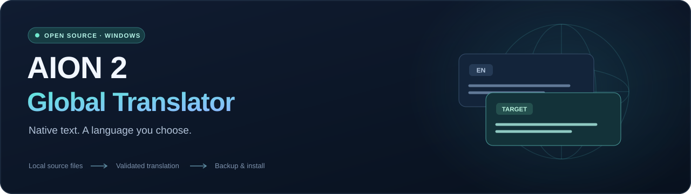

<p align="center">
  
</p>

<p align="center">
  <a href="README.md">English</a> ·
  <a href="docs/LANGUAGES.md">Dil uyumluluğu</a> ·
  <a href="docs/TRANSLATION.md">Çeviri iş akışı</a> ·
  <a href="CONTRIBUTING.md">Katkıda bulunun</a>
</p>

# AION 2 Global Translator

Kendi oyun kurulumunuzdan **AION 2'nin yerel metin dosyalarını çevirmek ve yönetmek** için geliştirilen ücretsiz, açık kaynaklı bir Windows uygulaması. Çeviri sağlayıcınızı seçin, yerel bir dil paketi oluşturun ve doğrulanmış yedekle kurun.

Hedef dil desteği, seçtiğiniz sağlayıcıya ve oyunun yazı tiplerine bağlıdır. Proje, bütün dillerin çalıştığını iddia etmez.

## Neler yapar?

- Desteklenen İngilizce yerelleştirme biçimini kendi oyun dosyalarınızdan okur.
- Sizin belirlediğiniz LibreTranslate uyumlu sunucuyla çalışır; dil listesini o sunucudan alır.
- Tam bir yerel JSON çeviri haritasını içe aktararak çevrimdışı paket oluşturur.
- Kayıt kimliklerini ve gerekli biçim öğelerini koruyarak yerel metin dosyası oluşturur.
- Orijinal dosyaları geri yüklemek üzere yedekler; değişiklikten önce oyun sürümünü denetler.
- Çeviriyi oluşturma ve oyuna kurma adımlarını ayırır; sonucu önce inceleyebilirsiniz.

Oyun, hazırlanan metin dosyasını doğrudan okur. Bu yöntem ekran görüntüsü OCR'ına dayanmaz. Seslendirme, görsellere gömülü yazılar ve canlı oyuncu sohbeti kapsam dışındadır.

## Mevcut durum

**Deneysel.** Kodlayıcı, Windows Steam **25926599** sürümünün **153.042 kayıt** içeren İngilizce metin tablosuyla doğrulandı. Kaynağı bayt düzeyinde koruyan yeniden yazım ve değiştirilmiş Unicode metnin kodlanıp geri okunması testleri geçti. Bunlar dosya biçimini doğrular; bütün oyunun sorunsuz çalıştığını kanıtlamaz.

**153.042 kayıtlı Türkçe yama üretildi ve yerel olarak kuruldu**; orijinal dosyaların yedeği korundu. **138.615 kayıt İngilizce kaynaktan farklı**, **1.022 anahtarda insan düzeltmesi** var. Biçim denetimleri ve yerel dosyanın kodlanıp geri okunması testi geçti. Aynı kalan 4.114 dilsel kayıt çoğunlukla özel adlar, sunucu adları, teknik geliştirme kayıtları ve ünlemlerden oluşuyor; incelemede bulunan uzun İngilizce görev ve başarım metinleri düzeltildi. Çalışma, seçilmiş insan düzeltmeleri içeren makine çevirisidir; bütünü insan tarafından gözden geçirilmiş bir yerelleştirme değildir.

Tam yama kurulu; yüklenmesi için oyunun sonraki açılışı gerekiyor. Oyun içindeki görünümü bağımsız olarak doğrulanmadı. Oyuna ait tam tablo, herkese açık indirmeye eklenmiyor. Paketlenmiş Windows uygulaması başarıyla açıldı ve [34 yapay veri testi yerel olarak geçti](CONTRIBUTING.md#tests).

| Alan | Durum |
| --- | --- |
| Windows Steam 25926599 / İngilizce kaynak | Kodlayıcı doğrulandı; oyuna kurulum deneysel |
| Türkçe | Tam yerel yama kuruldu, diskte doğrulandı; oyun içi görünüm doğrulanmadı |
| Diğer hedef diller | Sağlayıcının dil çiftine ve oyun içi yazı tipi denetimine bağlı |
| Diğer sürümler, bölgeler ve başlatıcılar | Doğrulanmadı |
| Ses, görseldeki yazı ve canlı sohbet | Bu metin yamasının kapsamı dışında |

Sağlayıcının bir dili sunmasıyla o dilin oyun içinde çalışması arasındaki fark için [dil uyumluluğu belgesine](docs/LANGUAGES.md) bakın.

## Başlangıç

### Windows uygulamasını indirme

[En son yayımın](https://github.com/arslanserhat/AION2-Global-Translator/releases/latest) Windows ZIP dosyasını indirip çıkarın; `AION2-Global-Translator.exe` uygulamasını çalıştırın. Uygulama dosyası yaklaşık **17,6 MB** boyutundadır. ZIP, `repak` 0.2.3 ve lisans bildirimlerini içerir; bu dağıtım için Python veya ayrıca `repak` indirmeniz gerekmez. Oyun DAT'ı ve tam çeviri tablosu içermez; çalışma dosyaları kendi kurulumunuzdan üretilir. [v0.1.0 yayım notlarını](docs/RELEASE-v0.1.0.md) inceleyebilirsiniz.

### Kaynak koddan çalıştırma

Python **3.12 veya üzerini** kurun; proje klasöründe şu komutları çalıştırın:

```powershell
py -3.12 -m venv .venv
.\.venv\Scripts\python.exe -m pip install -e .
.\.venv\Scripts\python.exe -m aion2_global_translator
```

Örnekteki Python sürümünü, bilgisayarınızda kurulu 3.12+ sürüme göre değiştirebilirsiniz. Windows için `Start-Translator.cmd` başlatma girişi de sağlanır. Paket kurulumu, `cryptography`, `blake3` ve `lz4` dahil bağımlılıkları yükler.

Windows uygulaması PyInstaller ile paketlenir. Yukarıdaki kaynak kurulumu, geliştirme ve kod incelemesi için kullanılabilir.

### Dil paketi hazırlama ve kurma

1. Güncel, yasal bir Steam AION 2 kurulumu kullanın. Mevcut iş akışının kaynak dili **İngilizce**dir.
2. Windows yayım ZIP'i `repak` içerir. Kaynak koddan kurulum için Windows `repak` **0.2.3** uygulamasını [kendi yayımından](https://github.com/trumank/repak/releases/tag/v0.2.3) indirin; `tools/repak.exe` yoluna koyun veya `REPAK_PATH` değişkenini bulunduğu konuma ayarlayın.
3. **Kurulumu kontrol et** ile kaynağı doğrulayın. Çevrimdışı harita için **Yeni çeviri oluştur… → Çevrimdışı JSON → İngilizce kaynağı dışa aktar…** yolunu kullanıp yerel çıktıdan tam bir harita hazırlayın. Çıkarılan oyun dosyaları ve tablolar bilgisayarınızda kalır.
4. Tam bir yerel JSON haritasını içe aktarın veya LibreTranslate uyumlu sunucu adresinizi, gerekiyorsa kendi API anahtarınızı girin. Hedef dil kodunu yazın; sağlayıcıyla çeviride bu kod, sunucunun dilleri ve İngilizce kaynak çifti üzerinden denetlenir.
5. Çeviriyi oluşturup inceleyin. Biçim hatalarını giderin; temel menüleri, yetenekleri, görev yönlendirmelerini ve bulmaca ipuçlarını kontrol edin.
6. AION 2'yi tamamen kapatın; **Hazır dil paketini kur…** ile oluşturulan paket klasörünü seçin. Orijinal yedeği saklayın. Oyunun metin dilini **English** olarak bırakıp çevrilmiş menüleri oyun içinde kontrol edin.

Uygulama ücretsizdir; harici çeviri hizmetinin kendi ücretleri, kullanım sınırları ve koşulları olabilir. LibreTranslate'i kendiniz de barındırabilirsiniz; bunun için [resmî kurulum belgesini](https://docs.libretranslate.com/guides/installation/) izleyin ve gerekli dil modellerini yükleyin.

Türkçe arayüzde **Kurulumu kontrol et**, **Türkçe paketini kur**, **Özgün dosyaları geri yükle**, **Yeni çeviri oluştur…** ve **Hazır dil paketini kur…** iş akışları bulunur; arayüz İngilizce de kullanılabilir. Paket oluşturma işlemi oyuna kurulum yapmaz. Türkçe kurmak için yerel olarak hazırlanmış uyumlu bir paket gerekir; herkese açık depo oyunun tam çevrilmiş tablosunu içermez. İçe aktarmadan önce [harita biçimi belgesini](docs/TRANSLATION.md#custom-maps) okuyun.

Çevrimdışı haritada değişmeden kalan dilsel metinler varsa `unchanged-review.json` raporu oluşturulur; bu kayıtları incelediğinizi açıkça onaylamadan paket hazırlanmaz. Yalnız bilerek aynı bırakılan adları veya etiketleri onaylayın; bu inceleme ve biçim doğrulaması, çevirinin bütünüyle doğru olduğunu kanıtlamaz.

## Güncellemeler ve geri yükleme

Başka bir yamaya geçmeden veya oyunu güncellemeden önce orijinal dosyaları geri yükleyin. Mevcut yamayı başka bir araç kurduysa önce o aracın geri yükleme yolunu kullanın. Yama ve yedeği belirli bir kaynak sürüme aittir; eski yedeği güncellenmiş oyunun üzerine yazmayın. Sürüm ya da hash denetimi başarısızsa güncel resmî dosyalardan yeni kaynak hazırlayın.

İstemci dosyalarını değiştirmek, oyunun koşulları veya bütünlük denetimleriyle çelişebilir. Projenin NC onayı ya da hesap güvenliği garantisi yoktur. İstemci kullanımını [oyunun bağlantı verdiği EULA](https://store.steampowered.com/eula/3393110_eula_0) düzenler.

## Bu depoda oyun verisi paylaşılmaz

Herkese açık depo; uygulama kaynağı, belgeler ve yapay test örneklerini içerir. Oyun DAT'ları, anahtar manifestleri, çıkarılmış veya çevrilmiş tam metin tabloları, oyun yedekleri, API bilgileri ve kişisel dosya yolları eklenmez. Çalışma dosyalarını kendi kurulumunuzdan üretirsiniz.

Ağ üzerinden çeviri etkinleştirildiğinde kaynak metin seçtiğiniz sunucuya gönderilir. Sağlayıcının erişim ve metin işleme koşullarını dikkate alın; kimlik bilgilerini ve çeviri önbelleklerini depoya göndermeyin.

## Emeği geçenler

Proje kaynağı [Apache-2.0](LICENSE) lisanslıdır; uyarlanmış kod ve bağımlılıklar için birlikte verilen üçüncü taraf bildirimlerini inceleyin.

Yerelleştirme kodlayıcısı, [CUE4Parse'ın AION 2 biçim çalışmasından](https://github.com/FabianFG/CUE4Parse/tree/master/CUE4Parse/GameTypes/Aion2) uyarlanmıştır. CUE4Parse [Apache-2.0](https://github.com/FabianFG/CUE4Parse/blob/master/LICENSE) lisanslıdır. `repak`, [MIT ve Apache-2.0 lisanslarıyla](https://github.com/trumank/repak) sunulur; kendi lisans bildirimleri Windows ZIP'ine eklenir. Dil listesi, seçtiğiniz sunucunun [LibreTranslate `/languages` arayüzünden](https://docs.libretranslate.com/api/operations/languages/) alınır.

AION 2 ve oyun içeriği NC'ye ve ilgili hak sahiplerine aittir. Bu proje bağımsız bir topluluk aracıdır; resmî bağlantı veya onay anlamına gelmez.
